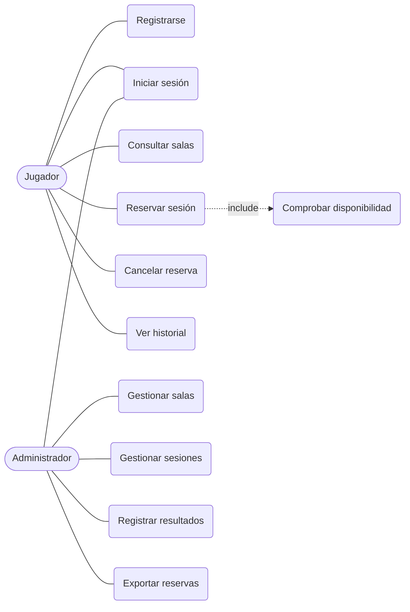

# ERS – Especificación de Requisitos Software
**Proyecto:** Sistema de creación y gestión de escape rooms · **Versión:** 1.0 (Sprint 1) · **Equipo:** Fer, David

## 1. Introducción
**Propósito:** definir los requisitos del sistema de gestión de un negocio de escape rooms presenciales.
**Alcance:** permite a los jugadores consultar salas, reservar y cancelar sesiones, y al administrador crear y gestionar salas, sesiones y resultados.
**Tipo de escape rooms elegido:** salas temáticas presenciales (terror, misterio, ciencia ficción) para grupos de 2 a 8 jugadores, con puzzles/retos y límite de 60 minutos.
**Definiciones:** RF = requisito funcional; RNF = requisito no funcional; Sesión = franja horaria en que una sala se juega.

## 2. Descripción general
**Actores:** *Jugador* (cliente que reserva) y *Administrador* (gestiona el negocio).
**Suposiciones:** el sistema se usa desde navegador; los pagos se realizan en el local (fuera del alcance).

## 3. Requisitos funcionales
| Id | Requisito |
|----|-----------|
| RF-01 | El sistema permitirá a un visitante registrarse indicando nombre, correo y contraseña. |
| RF-02 | El sistema validará usuario y contraseña al iniciar sesión y mostrará un mensaje de error si son incorrectos. |
| RF-03 | El sistema bloqueará la cuenta tras 5 intentos fallidos consecutivos de inicio de sesión. |
| RF-04 | El jugador podrá consultar el listado de escape rooms con nombre, temática, dificultad, duración y capacidad. |
| RF-05 | El jugador podrá consultar las sesiones disponibles de una sala por fecha. |
| RF-06 | El jugador podrá reservar una sesión indicando el número de jugadores, que no superará la capacidad de la sala. |
| RF-07 | El sistema impedirá reservar una sesión ya completa u ocupada. |
| RF-08 | El jugador podrá cancelar una reserva propia hasta 24 horas antes de la sesión. |
| RF-09 | El jugador podrá consultar el historial de sus reservas. |
| RF-10 | El administrador podrá crear, editar y eliminar escape rooms (nombre, temática, dificultad, duración, capacidad). |
| RF-11 | El administrador podrá crear y gestionar sesiones (sala, fecha, hora) y ver la disponibilidad de las salas. |
| RF-12 | El administrador podrá registrar el resultado de una sesión (equipo, tiempo, superada sí/no). |
| RF-13 | El administrador podrá exportar la lista de reservas a CSV seleccionando un rango de fechas. |

## 4. Requisitos no funcionales
| Id | Requisito |
|----|-----------|
| RNF-01 | El sistema será compatible con Chrome 139, Firefox 143 y Safari 17 o superiores. |
| RNF-02 | Las contraseñas se almacenarán con hash y sal aleatoria única por usuario. |
| RNF-03 | Las operaciones habituales (consulta y reserva) responderán en menos de 2 segundos. |
| RNF-04 | La interfaz será adaptable (responsive) a móvil y escritorio. |
| RNF-05 | Solo el administrador podrá acceder a las funciones de gestión (control de acceso por rol). |

## 5. Diagrama de casos de uso

## 6. Especificación de casos de uso
**Caso de uso: Reservar sesión** · Id: RF-06
- **Descripción:** el jugador reserva una sesión de una sala.
- **Actor primario:** Jugador · **Precondiciones:** sesión iniciada; existe una sesión libre.
- **Flujo principal:** 1) El jugador elige una sala. 2) El sistema muestra las sesiones disponibles. 3) El jugador elige sesión e indica nº de jugadores. 4) El sistema comprueba disponibilidad y capacidad. 5) El sistema registra la reserva y muestra confirmación.
- **Flujos alternativos:** *SesiónCompleta* (el sistema avisa y ofrece otra sesión); *CapacidadExcedida* (el sistema rechaza el nº de jugadores).
- **Postcondiciones:** la reserva queda registrada y la sesión pierde las plazas reservadas.

**Caso de uso: Validar usuario** · Id: RF-02
- **Actor primario:** Jugador / Administrador · **Precondición:** existe conexión.
- **Flujo principal:** 1) Pedir usuario. 2) Pedir contraseña. 3) Consultar en la base de datos. 4) Si es correcto, acceder según el rol.
- **Flujo alternativo:** credenciales incorrectas → mostrar error; tras 5 fallos, bloquear cuenta (RF-03).

## 7. Prototipo
Prototipo funcional en `src/index.html` (login, listado de salas, reserva y cancelación, panel de administración).
