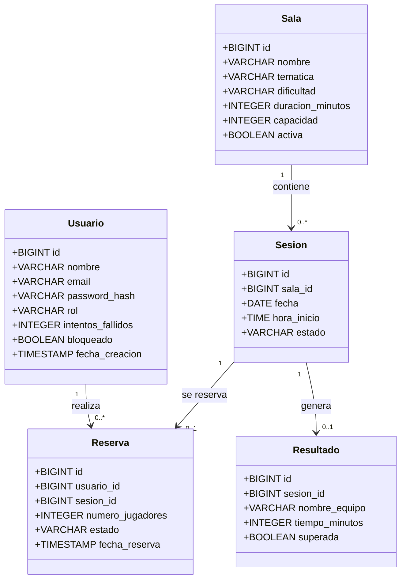

# Modelo de datos – Sprint 2

**Proyecto:** Sistema de creación y gestión de Escape Rooms  
**Sprint:** Sprint 2  
**Equipo:** Ferran y David  
**Versión:** 1.0

---

## 1. Introducción

Durante el Sprint 2 se desarrolla el modelo de datos del sistema de creación y gestión de Escape Rooms.

El objetivo es transformar los requisitos definidos durante el Sprint 1 en una estructura de datos capaz de almacenar de forma coherente la información necesaria para el funcionamiento de la aplicación.

El modelo se utilizará posteriormente para crear las tablas correspondientes en una base de datos PostgreSQL.

---

## 2. Entidades identificadas

A partir de la Especificación de Requisitos Software se han identificado cinco entidades principales:

- Usuario.
- Sala.
- Sesión.
- Reserva.
- Resultado.

Estas entidades permiten representar las funcionalidades principales definidas actualmente en la ERS.

---

## 3. Entidad Usuario

Representa a una persona que puede acceder al sistema.

Un usuario puede tener el rol de jugador o administrador.

### Atributos

| Atributo | Tipo | Descripción |
|---|---|---|
| id | BIGINT | Identificador único del usuario |
| nombre | VARCHAR(100) | Nombre del usuario |
| email | VARCHAR(255) | Correo electrónico |
| password_hash | VARCHAR(255) | Contraseña almacenada de forma segura |
| rol | VARCHAR(10) | Rol del usuario |
| intentos_fallidos | INTEGER | Número de intentos fallidos de inicio de sesión |
| bloqueado | BOOLEAN | Indica si la cuenta se encuentra bloqueada |
| fecha_creacion | TIMESTAMP | Fecha de creación de la cuenta |

### Restricciones

- `id` será la clave primaria.
- `email` deberá ser único.
- `nombre`, `email`, `password_hash` y `rol` serán obligatorios.
- `rol` únicamente podrá tomar los valores `JUGADOR` o `ADMIN`.
- `intentos_fallidos` no podrá ser negativo.

---

## 4. Entidad Sala

Representa un Escape Room disponible en el negocio.

### Atributos

| Atributo | Tipo | Descripción |
|---|---|---|
| id | BIGINT | Identificador único |
| nombre | VARCHAR(120) | Nombre de la sala |
| tematica | VARCHAR(80) | Temática |
| dificultad | VARCHAR(10) | Nivel de dificultad |
| duracion_minutos | INTEGER | Duración |
| capacidad | INTEGER | Capacidad máxima |
| activa | BOOLEAN | Indica si la sala está disponible |

### Restricciones

- `id` será la clave primaria.
- `nombre` deberá ser único.
- La dificultad podrá ser `BAJA`, `MEDIA` o `ALTA`.
- La duración deberá ser superior a cero.
- La capacidad mínima será de dos jugadores.

---

## 5. Entidad Sesión

Una sesión representa una franja concreta en la que puede jugarse una sala.

### Atributos

| Atributo | Tipo | Descripción |
|---|---|---|
| id | BIGINT | Identificador |
| sala_id | BIGINT | Sala asociada |
| fecha | DATE | Fecha |
| hora_inicio | TIME | Hora |
| estado | VARCHAR(12) | Estado de la sesión |

### Estados

Una sesión podrá encontrarse en alguno de estos estados:

- `DISPONIBLE`
- `RESERVADA`
- `CANCELADA`

### Restricciones

No podrán existir dos sesiones de una misma sala con la misma fecha y hora.

---

## 6. Entidad Reserva

Representa una reserva realizada por un jugador.

### Atributos

| Atributo | Tipo | Descripción |
|---|---|---|
| id | BIGINT | Identificador |
| usuario_id | BIGINT | Usuario que realiza la reserva |
| sesion_id | BIGINT | Sesión reservada |
| numero_jugadores | INTEGER | Número de participantes |
| estado | VARCHAR(10) | Estado de la reserva |
| fecha_reserva | TIMESTAMP | Momento de creación |

### Estados

- `ACTIVA`
- `CANCELADA`

### Restricciones

- Una reserva siempre pertenece a un usuario.
- Una reserva siempre pertenece a una sesión.
- El número de jugadores deberá ser superior a cero.
- Una sesión podrá tener como máximo una reserva activa en el modelo actual.

---

## 7. Entidad Resultado

Representa el resultado obtenido por el grupo después de jugar una sesión.

### Atributos

| Atributo | Tipo | Descripción |
|---|---|---|
| id | BIGINT | Identificador |
| sesion_id | BIGINT | Sesión asociada |
| nombre_equipo | VARCHAR(120) | Nombre del equipo |
| tiempo_minutos | INTEGER | Tiempo empleado |
| superada | BOOLEAN | Indica si se ha completado el Escape Room |

### Restricciones

- Cada resultado debe estar asociado a una sesión.
- Una sesión podrá tener como máximo un resultado.
- El tiempo empleado no podrá ser negativo.

---

## 8. Relaciones entre entidades

### Usuario – Reserva

Un usuario puede realizar múltiples reservas.

**Cardinalidad:**

`Usuario 1 — 0..* Reserva`

Cada reserva pertenece a un único usuario.

---

### Sala – Sesión

Una sala puede disponer de múltiples sesiones.

**Cardinalidad:**

`Sala 1 — 0..* Sesión`

Cada sesión pertenece a una única sala.

---

### Sesión – Reserva

Una sesión puede tener como máximo una reserva en el modelo actual.

**Cardinalidad:**

`Sesión 1 — 0..1 Reserva`

Cada reserva pertenece a una única sesión.

---

### Sesión – Resultado

Una sesión puede generar como máximo un resultado.

**Cardinalidad:**

`Sesión 1 — 0..1 Resultado`

---

## 9. Diagrama de clases

---

## 10. Correspondencia con la ERS

| Entidad | Requisitos relacionados |
|---|---|
| Usuario | RF-01, RF-02, RF-03 |
| Sala | RF-04, RF-10 |
| Sesión | RF-05, RF-07, RF-11 |
| Reserva | RF-06, RF-08, RF-09, RF-13 |
| Resultado | RF-12 |

---

## 11. Integridad de los datos

Para garantizar la coherencia del sistema se aplicarán:

- Claves primarias para identificar cada registro.
- Claves foráneas para representar relaciones.
- Restricciones `NOT NULL`.
- Restricciones `UNIQUE`.
- Restricciones `CHECK`.
- Integridad referencial entre tablas.

Por ejemplo:

- No podrá existir una reserva cuyo usuario no exista.
- No podrá existir una sesión asociada a una sala inexistente.
- No podrá existir un resultado asociado a una sesión inexistente.
- No podrán existir dos usuarios con el mismo correo.
- No podrán existir dos sesiones iguales para la misma sala, fecha y hora.

---

## 12. Implementación

Las tablas correspondientes a este modelo se implementarán mediante PostgreSQL.

Las peticiones SQL utilizadas para crear las tablas se encuentran en:

`src/db/schema.sql`

Este archivo permitirá construir el esquema de base de datos necesario para utilizar el modelo definido en este documento.

---

## 13. Conclusión

El modelo de datos definido durante el Sprint 2 permite representar la información principal necesaria para las funcionalidades actualmente especificadas en la ERS.

La estructura propuesta establece relaciones coherentes entre usuarios, salas, sesiones, reservas y resultados y servirá de base para continuar el desarrollo de la aplicación en los siguientes sprints.
