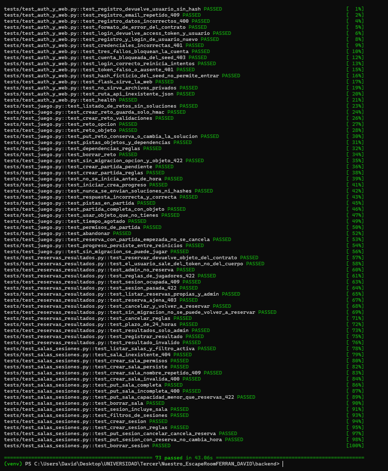
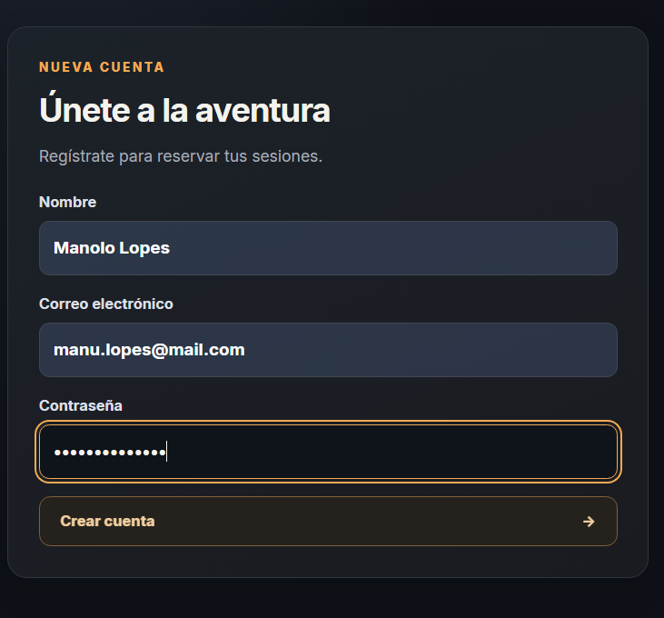
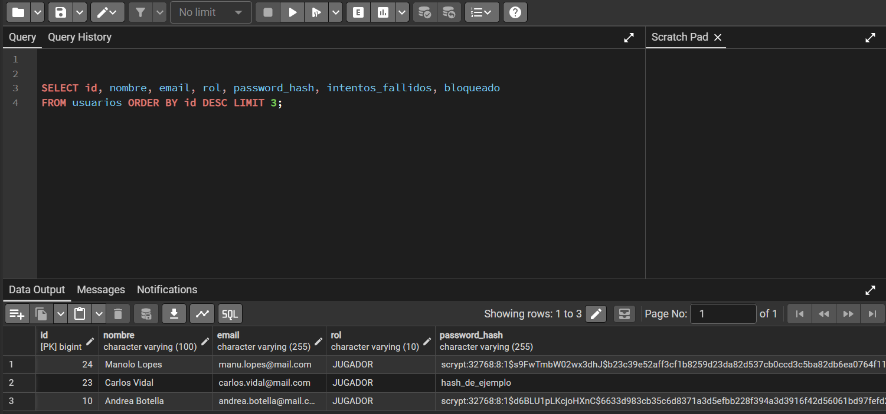
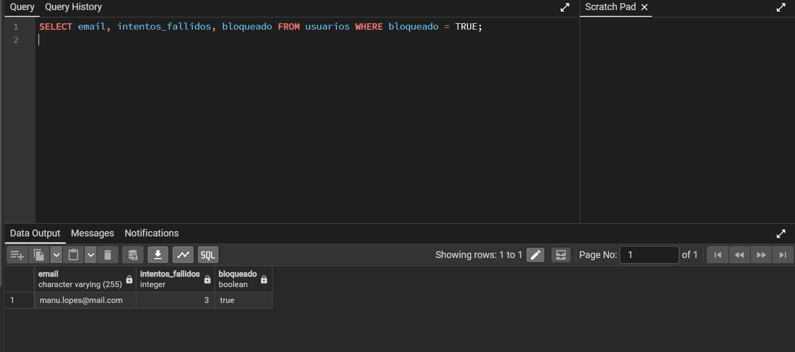
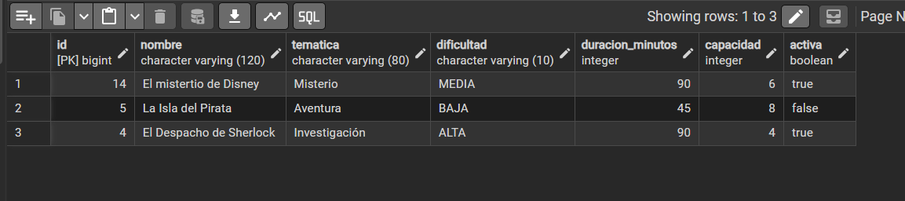
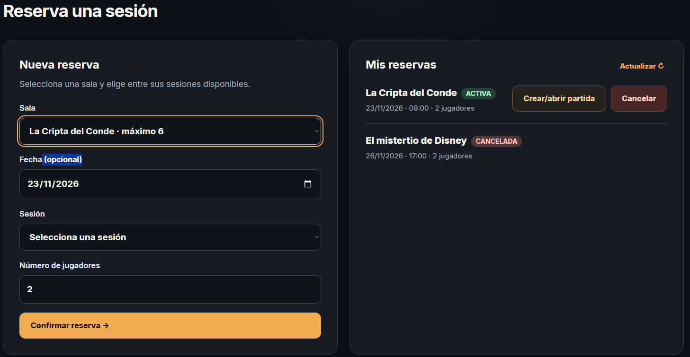
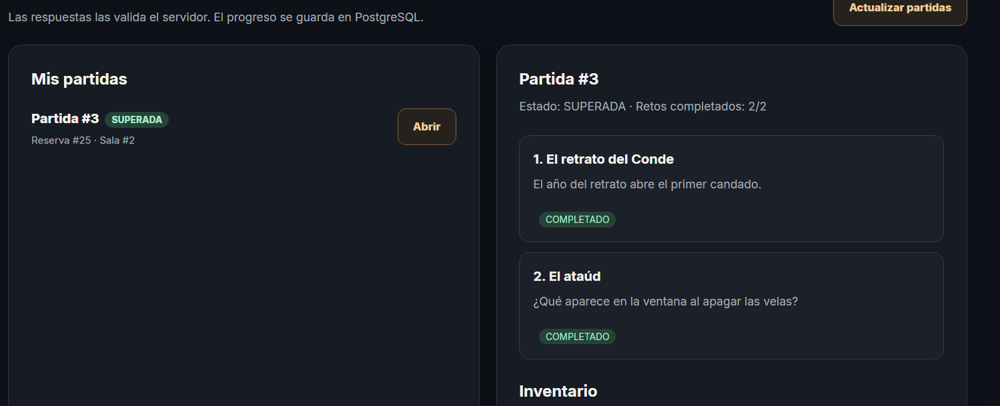

# Acta de reunión – Sprint Review

**Proyecto:** Sistema de creación y gestión de Escape Rooms  
**Sprint:** Sprint 3  
**Tipo de reunión:** Sprint Review  
**Fecha:** 23/11/2026  
**Asistentes:** Ferran y David  
**Duración aproximada:** 45 minutos  

---

## 1. Objetivo de la reunión

El objetivo de la reunión es revisar el trabajo realizado durante el Sprint 3 y comprobar si se ha cumplido el objetivo del sprint.

En la reunión se presenta el incremento obtenido, se realiza una prueba de integración completa entre la interfaz web, el servidor Flask y la base de datos PostgreSQL, y se identifican las mejoras que pasarán al siguiente sprint.

---

## 2. Objetivo del Sprint 3

El objetivo del Sprint 3 era conectar la aplicación con la base de datos mediante una API REST:

- Definir el contrato REST entre la interfaz y el servidor.
- Ampliar el modelo de datos con las tablas necesarias para el juego.
- Implementar el servidor Flask con SQLAlchemy y PostgreSQL.
- Conectar la interfaz web con la API.
- Verificar el funcionamiento con pruebas automáticas y de integración.

---

## 3. Trabajo completado

| Tarea | Responsable | Estado |
|---|---|---|
| Contrato de la API REST (`doc/api_rest.md`) | Ferran | Completada |
| Ampliación del modelo de datos: 9 tablas nuevas | Ferran | Completada |
| Actualización del diagrama de clases (UML) | Ferran | Completada |
| Cliente de la API (`src/js/api.js`) | Ferran | Completada |
| Interfaz web: acceso, reservas, partidas y administración | Ferran | Completada |
| D1 – Configurar Flask, dependencias y conexión PostgreSQL | David | Completada |
| D2 – API de salas y sesiones | David | Completada |
| D3 – API de usuarios y reservas | David | Completada |
| D4 – API del juego: retos, pistas, partidas, intentos, progreso y resultados | David | Completada |
| D5 – Pruebas y documentación | David | Completada |
| Revisión cruzada esquema / contrato / `api.js` | David | Completada |
| Migración del modelo (decisiones A, B y C) | David | Completada |
| Prueba de integración | Ferran y David | Completada |
| Sprint Review | Ferran y David | Completada |

---

## 4. Incremento obtenido

Al finalizar el sprint, el repositorio contiene:

```text
backend/                     Servidor Flask + SQLAlchemy
    app/                     Rutas, reglas de negocio y conexión a PostgreSQL
    tests/                   73 pruebas automáticas
    requirements.txt
    run.py
doc/
    api_rest.md              Contrato REST
    backend_sprint3.md       Notas de implementación
    revision_esquema_contrato_apijs.md
    scrum/sprint3/
src/
    index.html               Interfaz web (servida por Flask)
    js/api.js                Cliente de la API
    db/
        schema.sql, seed.sql, usuario.sql
        ampliacion_sprint3.sql, verificacion_sprint3.sql
        migracion_sprint3.sql
docker-compose.yml
```

### Arquitectura

```text
Navegador (HTML + api.js)  ──fetch / JSON──►  Flask (/api)  ──SQLAlchemy──►  PostgreSQL
```

- Flask sirve la interfaz web y la API desde el mismo origen (`http://127.0.0.1:5000`).
- La interfaz nunca accede directamente a la base de datos.
- Las rutas privadas usan un token (`Authorization: Bearer`) y el rol se comprueba siempre en el servidor.

### Modelo de datos

A las 5 tablas del Sprint 2 (`usuarios`, `salas`, `sesiones`, `reservas`, `resultados`) se añaden:

| Tabla | Descripción |
|---|---|
| `retos` | Pruebas de cada sala (CODIGO, TEXTO, OPCION, OBJETO); la solución se guarda solo como HMAC |
| `dependencias_reto` | Qué retos hay que completar antes de otro |
| `pistas` | Ayudas de cada reto, con penalización en segundos |
| `objetos` | Objetos que se pueden recoger en una sala |
| `partidas` | Partida asociada a una reserva |
| `progreso_retos` | Estado de cada reto en la partida (BLOQUEADO, DISPONIBLE, COMPLETADO) |
| `intentos_reto` | Respuestas enviadas |
| `pistas_utilizadas` | Pistas usadas en cada partida |
| `inventario_partida` | Objetos recogidos y si se han usado |
| `opciones_reto` | Alternativas de los retos OPCION (migración) |

---

## 5. Demostración

Durante la reunión se realiza una prueba de integración completa desde el navegador, comprobando en pgAdmin que los datos se guardan en PostgreSQL:

1. Arranque de PostgreSQL y del servidor Flask; carga de los datos de demostración.
2. Registro de un usuario nuevo e inicio de sesión.
3. Bloqueo de la cuenta tras tres contraseñas incorrectas.
4. Creación de una sala desde el panel de administración.
5. Reserva de una sesión y cancelación de otra.
6. Creación, inicio y resolución completa de una partida, incluido el uso de pistas.
7. Comprobación del resultado y de la persistencia en la base de datos.

---

## 6. Resultados de las pruebas

### Pruebas automáticas

Se ejecutan **73 pruebas automáticas** (`python -m pytest`) contra una base de datos PostgreSQL de pruebas que se recrea antes de cada prueba. **Todas se superan.**

Cubren todos los apartados del contrato: autenticación, salas, sesiones, reservas, resultados, administración de retos y partidas. Incluyen los retos de tipo OPCION y OBJETO, permisos, validaciones y persistencia, tanto con la migración aplicada como sin ella.



### Prueba de integración

#### Registro de usuario

El usuario se registra desde la web. En la base de datos la contraseña se guarda cifrada con sal (`scrypt`), nunca en claro.





#### Bloqueo de cuenta

Tras tres contraseñas incorrectas seguidas, la cuenta queda bloqueada (`bloqueado = true`, `intentos_fallidos = 3`).



#### Administración de salas

La sala creada desde el panel de administración queda guardada en la tabla `salas`.



#### Reservas

El jugador reserva una sesión de *La Cripta del Conde* (estado ACTIVA) y cancela otra reserva (estado CANCELADA). Desde la reserva activa se accede a la partida.



#### Partida completa

Se crea la partida, se inicia y se resuelven los dos retos de la sala, usando una pista. La partida termina como **SUPERADA** con los 2 retos completados, y el resultado se guarda en PostgreSQL.



### Resumen de comprobaciones

| Comprobación | Resultado |
|---|---|
| Registro e inicio de sesión | Funciona |
| Contraseñas cifradas con sal | Funciona |
| Bloqueo tras 3 intentos fallidos | Funciona |
| Panel de administración (salas) | Funciona |
| Reservar y cancelar | Funciona |
| Crear, iniciar y jugar una partida | Funciona |
| Pistas con penalización | Funciona |
| Retos bloqueados hasta completar sus prerrequisitos | Funciona |
| Resultado guardado al terminar la partida | Funciona |
| Datos persistentes en PostgreSQL | Funciona |
| Permisos (jugador / administrador / titular) | Funciona (pruebas automáticas) |
| Doble reserva simultánea de una misma sesión | Rechazada (pruebas automáticas) |

---

## 7. Comprobación de los criterios de aceptación del contrato

| Criterio | Cumplido |
|---|---|
| Todas las rutas devuelven JSON válido y los códigos HTTP esperados | Sí |
| Un GET no modifica tablas; un POST devuelve 201 y un recurso identificable | Sí |
| Los datos siguen presentes tras reiniciar el servidor | Sí |
| Un jugador no puede hacer operaciones de administrador ni ver reservas ajenas | Sí |
| No se puede reservar dos veces la misma sesión simultáneamente | Sí |
| Se rechazan reservas fuera de capacidad y cancelaciones fuera de plazo | Sí |
| Retos, pistas, objetos e intentos se guardan en las tablas del modelo ampliado | Sí |
| El backend nunca devuelve soluciones, hashes ni pistas no desbloqueadas | Sí |
| Las partidas ajenas no pueden consultarse ni modificarse | Sí |
| El progreso y el inventario se recuperan al volver a iniciar sesión | Sí |
| Los nombres de los campos coinciden con el contrato | Sí |
| Los mensajes de error son útiles y no contienen información sensible | Sí |

---

## 8. Problemas y soluciones

- **Ubicación del backend en el repositorio:** el backend se encontraba en `backend/` y no en `src/backend/`. Se adapta para que localice automáticamente la carpeta `src/` en ambas organizaciones.
- **Archivos ocultos al copiar:** `.gitignore` y `.env.example` no se habían copiado. Se crean de nuevo para no subir el entorno `venv/` ni las claves del archivo `.env`.
- **Conexión a PostgreSQL en Windows:** la conexión con `localhost` se quedaba esperando. Se utiliza `127.0.0.1` con un tiempo máximo de conexión.
- **Usuarios de prueba:** los hashes ficticios del seed del Sprint 2 no permitían iniciar sesión. Se añade un comando de demostración que asigna una contraseña de prueba leída del archivo `.env` local, sin subirla a GitHub.
- **Re-reservar una sesión cancelada:** la restricción `UNIQUE` del Sprint 2 lo impedía. Se sustituye por un índice que solo permite una reserva activa por sesión (migración A).

---

## 9. Acuerdos

Se acuerda:

1. Dar por cumplido el objetivo del Sprint 3.
2. Aprobar las decisiones A, B, C y F de la revisión cruzada (re-reserva, retos OPCION, retos OBJETO y ruta relativa `/api`).
3. Utilizar el nombre del titular de la reserva como nombre predeterminado del equipo (decisión D).
4. Revisar en detalle las reglas del juego (decisión E) al inicio del siguiente sprint.
5. Cerrar los issues completados del milestone `Sprint 3`.

---

## 10. Próximos pasos

Para el siguiente sprint se proponen las siguientes tareas:

| Tarea | Responsable |
|---|---|
| Revisión final de las reglas del juego (decisión E) | Ferran y David |
| Probar en la interfaz una partida completa de la sala 1 (retos OPCION y OBJETO) | Ferran y David |
| Edición y borrado de pistas y objetos desde el panel de administración | David |
| Nombre de equipo personalizable al crear la partida | Por asignar |
| Mejoras visuales del panel de administración | Ferran |

---

## 11. Conclusión

El Sprint 3 se ha completado correctamente. La interfaz web, el servidor Flask y la base de datos PostgreSQL funcionan integrados: los usuarios pueden registrarse, reservar sesiones y jugar partidas, y el administrador puede gestionar salas, sesiones y retos. Las 73 pruebas automáticas se superan y la prueba de integración confirma que los datos se guardan correctamente en PostgreSQL.
