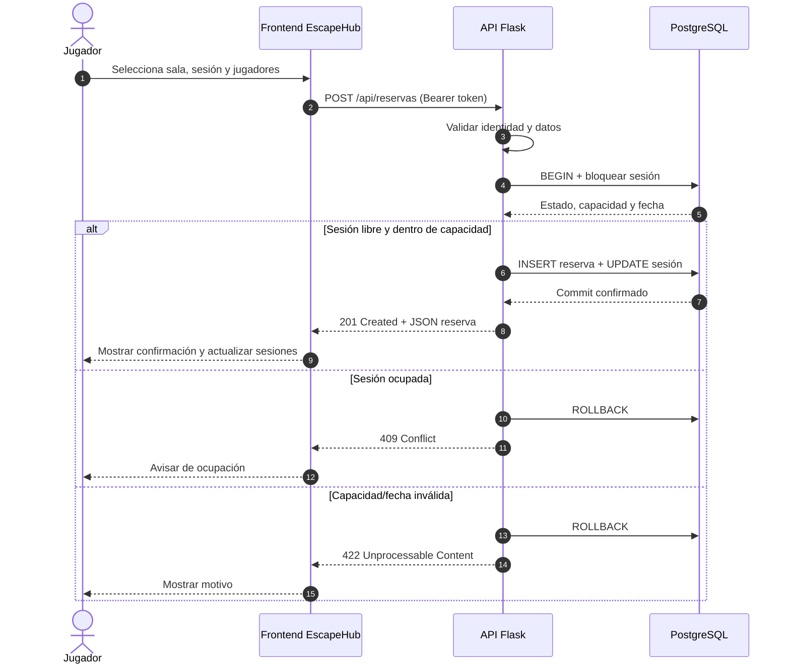
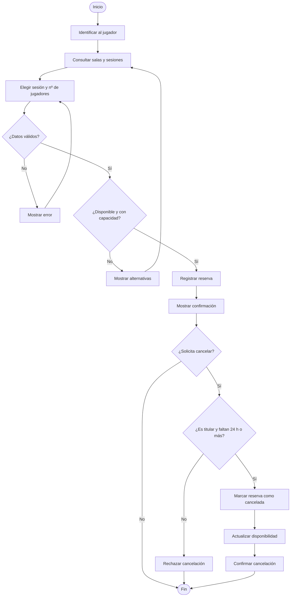
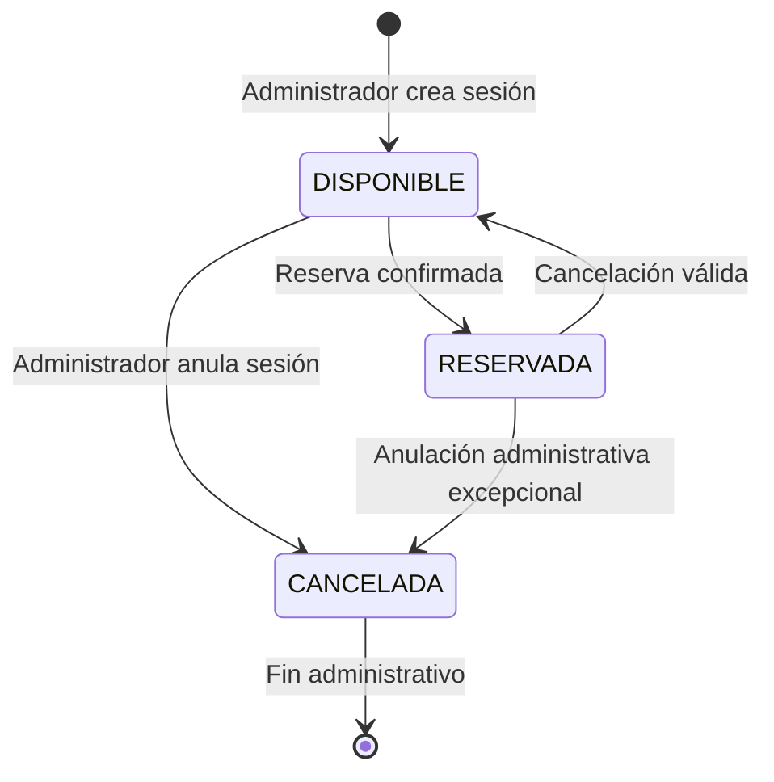
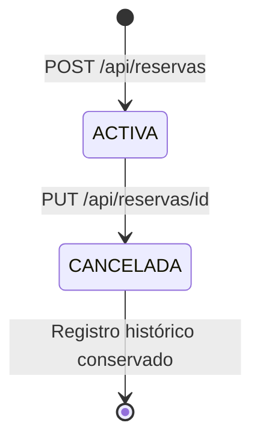
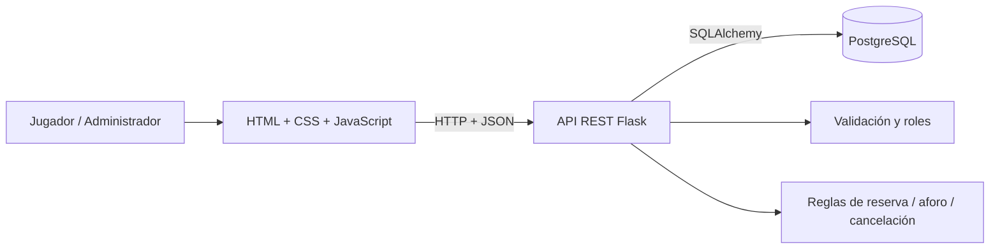
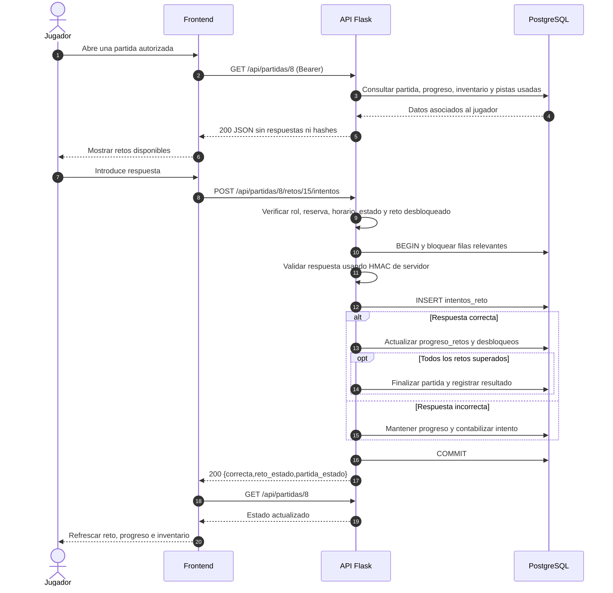
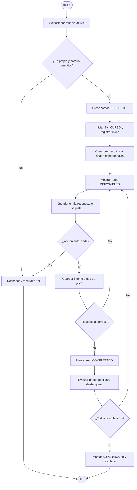
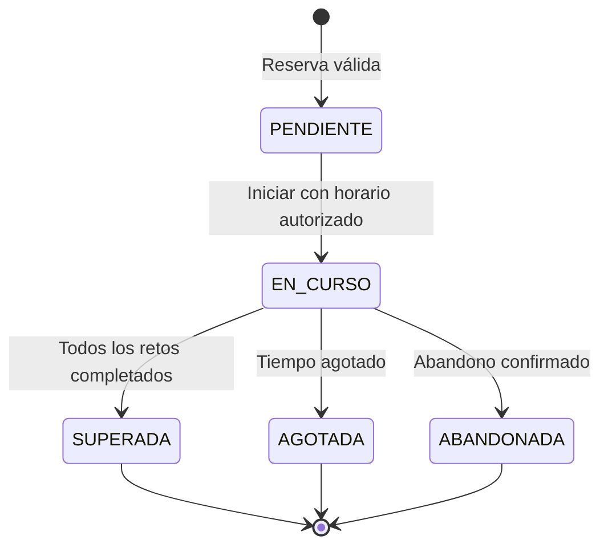
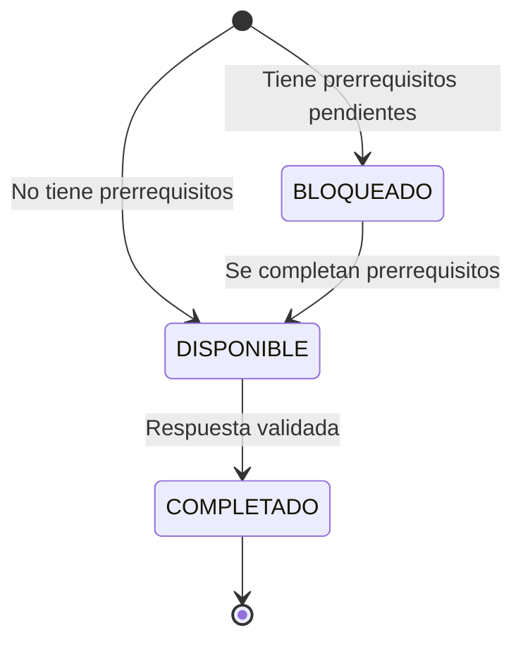
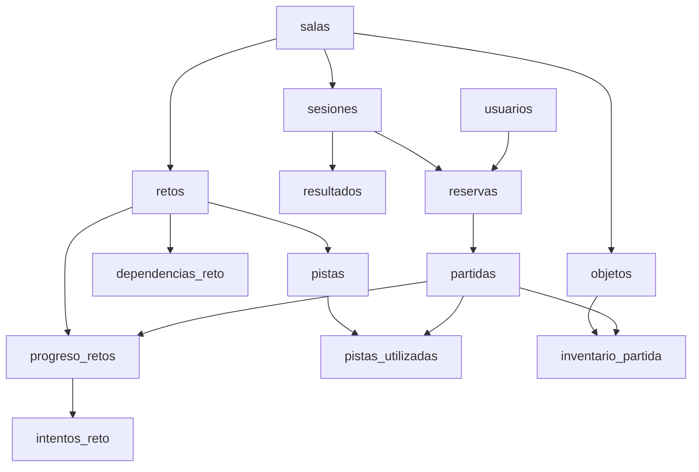

# Diagramas UML del Sprint 3 — EscapeHub

**Proyecto:** Sistema de creación y gestión de Escape Rooms · **Autor de la documentación:** Ferran  
**Objetivo:** representar las interacciones y estados asociados a recursos REST, de acuerdo con el modelo de datos ampliado al finalizar Sprint 2 (14 tablas).

Los diagramas están escritos en Mermaid para renderizarse directamente en GitHub. No son imágenes estáticas; pueden mantenerse y versionarse con el código. **La lógica de servidor dibujada es el diseño objetivo, no una afirmación de que David ya la haya implementado.**

## 1. Secuencia: reservar una sesión

**Explicación:** una reserva se hace mediante `POST`; el backend es quien comprueba ocupación y aforo, no el navegador. La operación de verificación y escritura debe ser atómica para evitar reservas simultáneas.

## 2. Actividad: reserva y cancelación

**Explicación:** el diagrama señala las validaciones, alternativas y regla temporal del RF-08. Las acciones sobre la base de datos son responsabilidad del servicio.

## 3. Estados: ciclo de vida de una sesión

**Nota:** `CANCELADA` es el estado de la **sesión**, diferente de una reserva histórica cancelada. Las reglas para anulación administrativa con una reserva activa deben decidirse e implementarse de manera explícita.

## 4. Estados: ciclo de vida de una reserva

**Explicación:** una reserva cancelada se conserva para el historial. La sesión vuelve a estar disponible si la cancelación es válida. No se elimina el historial.

## 5. Componentes: división de responsabilidades

## 6. Relación con el modelo de datos y los requisitos

| Recurso | Tabla SQL | Requisitos | Diagrama relevante |
|---|---|---|---|
| Usuario | `usuarios` | RF-01, RF-02, RF-03 | Componentes / autenticación |
| Sala | `salas` | RF-04, RF-10 | Componentes |
| Sesión | `sesiones` | RF-05, RF-07, RF-11 | Secuencia, estados |
| Reserva | `reservas` | RF-06, RF-08, RF-09 | Secuencia, actividad, estados |
| Resultado | `resultados` | RF-12 | Componentes |

Los diagramas representan el comportamiento deseado del sistema a través de REST. Si durante la implementación se cambia el contrato de la API, se actualizarán antes de cerrar el issue.

## 7. Diagrama de secuencia: resolver un reto y persistir el progreso

## 8. Actividad: iniciar partida y desbloquear retos

## 9. Estados de una partida

## 10. Estados de un reto dentro de una partida

## 11. Recursos SQL y responsabilidad

**Nota del diagrama:** son relaciones lógicas; la implementación SQL contiene FKs simples y compuestas. `dependencias_reto` referencia dos veces a `retos`, y `pistas_utilizadas` asocia partida, reto y pista. Las decisiones sobre respuestas de tipo `OBJETO`, penalización y autorización son lógica de negocio, no se delegan al frontend.
